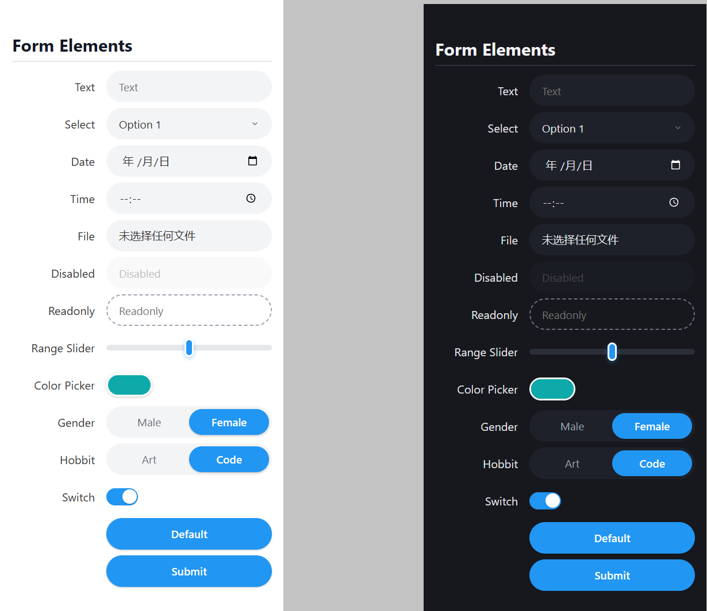

# Classless Capsule CSS

Capsule style, class-less css framework for resource constrained MCU.
[demo](https://jojo-joo.github.io/classless-capsule-css/) is here.

## Goals

considering the reources constrained in embedded system(resource constrained MCU), 
this framwork not aimed at full functionity, beautiful, interactive;
but concentrate on 
- minimal footprint
- compact layout
- zero dependency
- modern style eg switch & theme
- easy study

## Showcase

